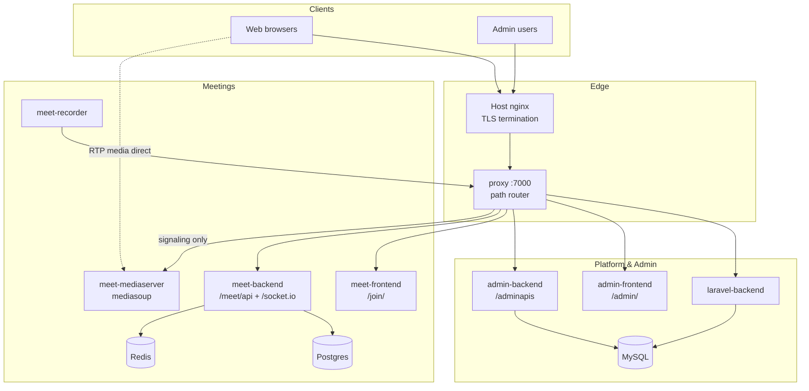

# Avnik

**Avnik** is a Docker-based platform for events, admin operations, and real-time video meetings. This monorepo runs the full product with a single Compose stack: Laravel platform, admin dashboard, Nest meeting API, mediasoup SFU, React join UI, and an edge HTTP proxy.

```text
https://meet-staging.avnik.com  →  host nginx (TLS)  →  proxy:7000  →  microservices
```

---

## Table of contents

- [Features](#features)
- [Product structure](#product-structure)
- [Architecture](#architecture)
- [Repository layout](#repository-layout)
- [Prerequisites](#prerequisites)
- [Quick start (developers — Windows + WSL)](#quick-start-developers--windows--wsl)
- [Install & run on Ubuntu server (production)](#install--run-on-ubuntu-server-production)
- [Configuration](#configuration)
- [Useful URLs & ports](#useful-urls--ports)
- [Operations](#operations)
- [Documentation](#documentation)
- [CI / CD](#ci--cd)
- [Troubleshooting](#troubleshooting)
- [Contributing](#contributing)
- [License](#license)

---

## Features

- **Platform website** — Laravel app for users, events, profiles, and APIs
- **Admin console** — React dashboard + Express admin API
- **Video meetings** — Join UI (`/join/`), Nest meeting API, Socket.IO presence
- **WebRTC SFU** — mediasoup for selective audio/video forwarding
- **Recording** — Headless Chrome recorder via Puppeteer
- **Single edge entry** — Internal `proxy` service routes all HTTP paths (TLS stays on host nginx)

---

## Product structure



**Path routing (via `proxy`):**

| Path | Service |
|------|---------|
| `/` | Laravel platform |
| `/admin/` | Admin React SPA |
| `/adminapis` | Admin Express API |
| `/join/` | Meeting React SPA |
| `/meet/api/`, `/socket.io/`, `/uploads/` | Meeting Nest API |
| `/mediasoup-socket.io/` | mediasoup signaling |
| `/myadmin/` | phpMyAdmin |

WebRTC **media (RTP)** goes directly to the mediaserver announced IP / RTC ports — not through nginx.

---

## Architecture

| Layer | Responsibility |
|-------|----------------|
| Host nginx | HTTPS certificates, forward all traffic to `127.0.0.1:7000` |
| `proxy` container | HTTP path routing to Docker services (no TLS) |
| App containers | Business logic and UIs |
| MySQL / Postgres / Redis | Persistence and cache |

Deep dives:

- [docs/architecture-overview.md](docs/architecture-overview.md) — services, proxy, Compose
- [docs/mediasoup-av-overview.md](docs/mediasoup-av-overview.md) — audio/video SFU flow
- [docs/Avnik-Windows-WSL-Setup-Guide.pdf](docs/Avnik-Windows-WSL-Setup-Guide.pdf) — detailed Windows/WSL guide

---

## Repository layout

```text
avnik/
├── README.md
├── compose.yaml                 # Local / developer stack
├── compose.prod.yaml            # Production stack
├── .env.example                 # Template for secrets & ports
├── proxy/                       # Edge router (Dockerfile + routes)
├── avnik-admin-laravel-backend/ # Platform (Laravel)
├── avnik-admin-backend/         # Admin API (Node)
├── avnik-admin-frontend/        # Admin UI (React)
├── meet-backend/                # Meeting API (NestJS)
├── meet-frontend/               # Meeting UI (React)
├── meet-mediaserver/            # mediasoup SFU
├── meet-recorder/               # Meeting recorder
├── meet-mobile/                 # Mobile client (not in Compose)
├── docs/                        # Architecture & setup docs
└── .github/workflows/           # Deploy workflows
```

---

## Prerequisites

### All environments

| Requirement | Notes |
|-------------|--------|
| Git | Clone this repository |
| Docker Engine | 24+ recommended |
| Docker Compose | v2 (`docker compose`) |
| Open ports | See [Useful URLs & ports](#useful-urls--ports); WebRTC needs UDP RTC range |

### Ubuntu server (production)

- Ubuntu 22.04 / 24.04 LTS (or similar)
- Domain DNS pointing at the server
- TLS certificates (e.g. under `/etc/nginx/ssl/`)
- Host **nginx** for HTTPS (template provided)
- Firewall allowing: `80`, `443`, `7000` (localhost), mediasoup **UDP** RTC range (e.g. `45000–45100`), and TURN if used

### Windows developers (WSL)

- Windows 10/11 with **WSL2** (Ubuntu distro recommended)
- [Docker Desktop](https://www.docker.com/products/docker-desktop/) with **WSL2 backend** enabled
- Git inside WSL (clone into the Linux filesystem, e.g. `~/projects`, not `C:\…`, for better performance)

---

## Quick start (developers — Windows + WSL)

### 1. Prepare WSL + Docker

1. Install WSL2 and an Ubuntu distro: `wsl --install` (from PowerShell as admin if needed).
2. Install Docker Desktop; enable **Settings → Resources → WSL Integration** for your distro.
3. Open an Ubuntu WSL terminal and verify:

```bash
docker version
docker compose version
```

For a longer walkthrough (networking, file paths, common pitfalls), see [docs/Avnik-Windows-WSL-Setup-Guide.pdf](docs/Avnik-Windows-WSL-Setup-Guide.pdf).

### 2. Clone and configure

```bash
cd ~
git clone git@github.com:avnikl/avnik.git avnik
cd avnik
cp .env.example .env
```

Edit `.env` at minimum:

- MySQL passwords (`MYSQL_*`) — do **not** set `MYSQL_USER=root`
- `JWT_SECRET`, `APP_KEY` (Laravel)
- Meeting secrets: `BACKEND_MEDIA_JWT_SECRET`, `MEDIASERVER_MEDIA_JWT_SECRET`, Postgres credentials
- `PROXY_PORT=7000`
- For local media: `MEDIASERVER_ANNOUNCED_IP=127.0.0.1,host.docker.internal` (adjust if needed)

### 3. Start the stack

```bash
docker compose up --build
```

### 4. Open the app

Use the **edge proxy** as the single entry:

| URL | What |
|-----|------|
| http://localhost:7000/ | Platform (Laravel) |
| http://localhost:7000/admin/ | Admin UI |
| http://localhost:7000/join/ | Meeting UI |
| http://localhost:7000/myadmin/ | phpMyAdmin |

Dev Compose uses bind mounts and Vite HMR. Project name: `avnik-dev`.

**Windows tip:** Prefer running Compose **inside WSL**, and open URLs from Windows browsers against `localhost` (Docker Desktop publishes ports to Windows).

---

## Install & run on Ubuntu server (production)

### 1. Install Docker

```bash
sudo apt update
sudo apt install -y ca-certificates curl git nginx

# Official Docker Engine (example — follow current Docker docs for your Ubuntu version)
curl -fsSL https://get.docker.com | sudo sh
sudo usermod -aG docker "$USER"
# log out / in, then:
docker compose version
```

### 2. Clone the project

```bash
sudo mkdir -p /opt/apps
sudo chown "$USER":"$USER" /opt/apps
cd /opt/apps
git clone <YOUR_REPO_URL> avnik
cd avnik
git checkout dev   # or your deploy branch
```

### 3. Create production `.env`

```bash
cp .env.example .env
nano .env
```

Set production values (examples — use strong secrets):

```env
# Database — dedicated app user, not root
MYSQL_USER=avnik_user
MYSQL_PASSWORD=<strong-password>
MYSQL_ROOT_PASSWORD=<strong-root-password>

APP_ENV=production
APP_DEBUG=false
APP_KEY=base64:<php artisan key:generate value>
LARAVEL_APP_URL=https://staging.avnik.com
FORCE_HTTPS=true

PROXY_PORT=7000
RECORDER_FRONTEND_URL=http://proxy:7000/join

# Public IP clients use for WebRTC ICE
MEDIASERVER_ANNOUNCED_IP=<SERVER_PUBLIC_IP>
MEDIASERVER_RTC_MIN_PORT=45000
MEDIASERVER_RTC_MAX_PORT=45100

# Shared media JWT secret (backend + mediaserver)
BACKEND_MEDIA_JWT_SECRET=<secret>
MEDIASERVER_MEDIA_JWT_SECRET=<same-secret>

# Meeting Postgres
POSTGRES_USER=meet
POSTGRES_PASSWORD=<strong-password>
POSTGRES_DB=meet
BACKEND_DATABASE_URL=postgres://meet:<strong-password>@postgres:5432/meet
```

Also set admin/meeting frontend URLs to your public HTTPS origin (e.g. `FRONTEND_VITE_MEETING_FRONT_URL`, `FRONTEND_VITE_MEETING_API_URL`, `FRONTEND_VITE_MEETING_REDIRECT_URL`).

### 4. Start containers

```bash
docker compose -f compose.prod.yaml up -d --build
docker compose -f compose.prod.yaml ps
```

Confirm proxy:

```bash
curl -I http://127.0.0.1:7000/
```

### 5. Configure host nginx (TLS)

Copy the provided template and adjust certificate paths / `server_name`:

```bash
sudo cp proxy/staging.avnik.com.nginx.host /etc/nginx/sites-available/staging.avnik.com
sudo ln -sf /etc/nginx/sites-available/staging.avnik.com /etc/nginx/sites-enabled/
sudo nginx -t && sudo systemctl reload nginx
```

Host nginx should **only** terminate TLS and proxy to `http://127.0.0.1:7000`. All path routing lives in `proxy/routes.conf`.

### 6. Firewall (example)

```bash
sudo ufw allow OpenSSH
sudo ufw allow 80/tcp
sudo ufw allow 443/tcp
sudo ufw allow 45000:45100/udp   # mediasoup RTC — match your .env
sudo ufw enable
```

### 7. Verify

- https://your-domain/
- https://your-domain/admin/
- https://your-domain/join/
- Start a test meeting and confirm two-way audio/video

---

## Configuration

| File | Purpose |
|------|---------|
| `.env` | Runtime secrets and ports (gitignored) |
| `.env.example` | Documented template — copy to `.env` |
| `compose.yaml` | Development services (`avnik-dev`) |
| `compose.prod.yaml` | Production services (`avnik-prod`) |
| `proxy/routes.conf` | Prod path → upstream map |
| `proxy/routes.dev.conf` | Dev path → Vite / artisan ports |
| `proxy/staging.avnik.com.nginx.host` | Host SSL → `:7000` |

**Important**

- Never commit `.env`.
- `MYSQL_USER` must not be `root` (MySQL image restriction).
- After renaming Compose project names, Docker volumes change prefix — migrate data if databases appear empty.
- Rebuild `meet-frontend` / `admin-frontend` after changing Vite build-time env vars.

---

## Useful URLs & ports

| Port | Service |
|------|---------|
| **7000** | Edge `proxy` (preferred entry) |
| 8000 | Laravel |
| 8001 | Admin API |
| 8002 / 8003 | Admin frontend (prod / dev) |
| 3000 | Meet API |
| 3001 | Mediaserver signaling |
| 3002 | Meet frontend publish (prod) |
| 4000 | Recorder |
| 3306 | MySQL |
| 5432 | Postgres |
| 6379 | Redis |
| 8080 | phpMyAdmin (direct; also `/myadmin/` via proxy) |
| 45000–45100/udp | mediasoup RTC (typical) |

---

## Operations

```bash
# Logs
docker compose -f compose.prod.yaml logs -f proxy
docker compose -f compose.prod.yaml logs -f meet-mediaserver

# Restart one service
docker compose -f compose.prod.yaml up -d --build meet-frontend

# Stop stack
docker compose -f compose.prod.yaml down

# Status
docker compose -f compose.prod.yaml ps
```

Redeploy after git pull:

```bash
cd /opt/apps/avnik
git pull
docker compose -f compose.prod.yaml up -d --build
docker image prune -f
```

---

## Documentation

| Document | Description |
|----------|-------------|
| [docs/architecture-overview.md](docs/architecture-overview.md) | Microservices, proxy, Compose, ports |
| [docs/mediasoup-av-overview.md](docs/mediasoup-av-overview.md) | WebRTC / mediasoup A/V design |
| [docs/Avnik-Windows-WSL-Setup-Guide.pdf](docs/Avnik-Windows-WSL-Setup-Guide.pdf) | Windows + WSL developer setup |

---

## CI / CD

Pushing to the `dev` branch can trigger an SSH deploy (see `.github/workflows/deploy-dev.yml`):

- Secrets typically required: `SSH_HOST`, `SSH_USER`, `SSH_PRIVATE_KEY`, `SSH_PORT`, `PROJECT_PATH`
- Remote steps: `git reset --hard origin/dev` then `docker compose -f compose.prod.yaml up -d --build`

Configure repository secrets before enabling automated deploys.

---

## Troubleshooting

| Symptom | What to check |
|---------|----------------|
| `MYSQL_USER="root"` container exit | Use a non-root `MYSQL_USER` in `.env` |
| Empty `avnik_db` after deploy | Compose project rename created new volumes — restore from previous volume |
| Fonts / icons missing on `/join/` | Ensure `meet-frontend/public/vendor/` is committed (not ignored by Laravel `vendor/` rules) |
| Site loads, no A/V | `MEDIASERVER_ANNOUNCED_IP`, UDP RTC firewall, TURN settings |
| 502 from public HTTPS | `proxy` up on `:7000`; host nginx points to `127.0.0.1:7000` |
| Recorder has no media | `RECORDER_FRONTEND_URL=http://proxy:7000/join` |

---

## Contributing

1. Create a feature branch from `dev`.
2. Use `compose.yaml` for local work; keep changes scoped to the service you touch.
3. Do not commit `.env`, secrets, or local Docker overrides.
4. Update docs under `docs/` when behavior or routing changes.
5. Open a PR and note any Compose / env / migration impact.

---

## License

Proprietary — All rights reserved. Contact the Avnik team for licensing terms.

---

## Support

For architecture questions, start with [docs/architecture-overview.md](docs/architecture-overview.md). For WebRTC issues, see [docs/mediasoup-av-overview.md](docs/mediasoup-av-overview.md).
