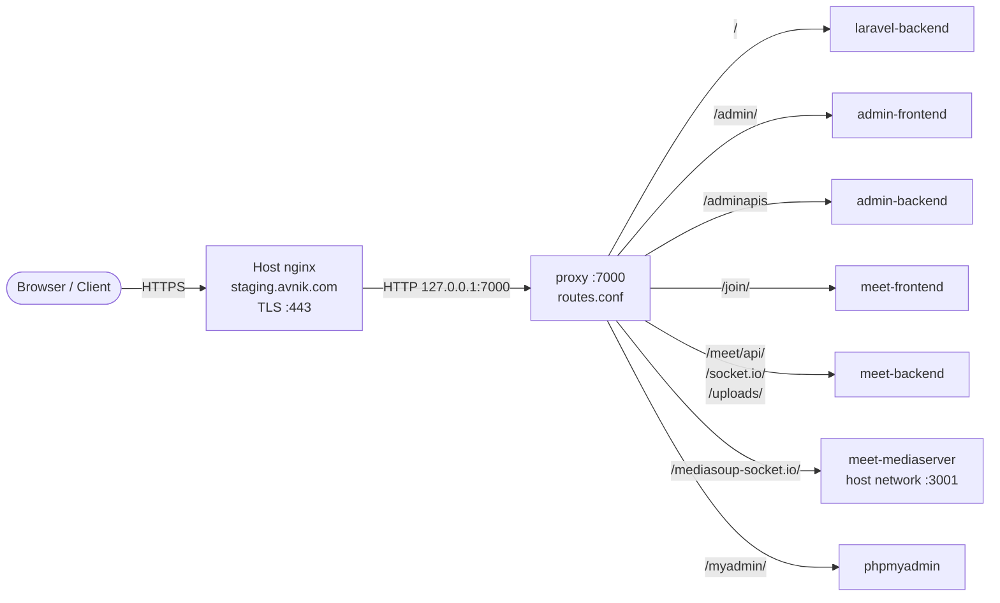
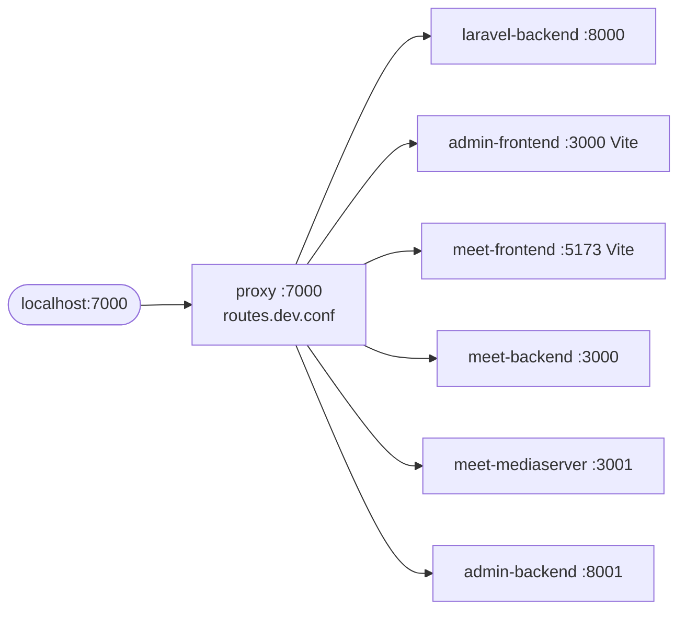
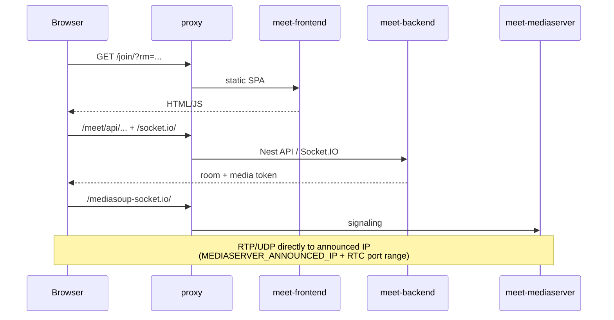
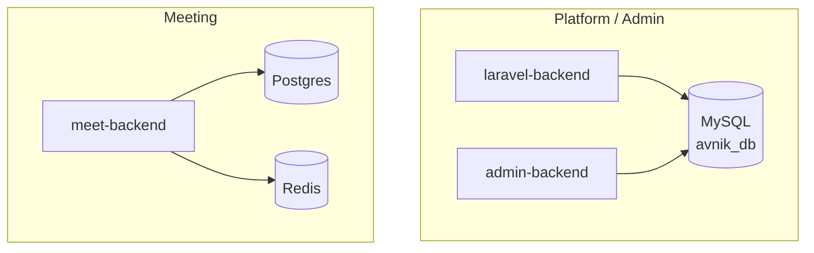

# Avnik — Microservices Architecture Overview

High-level guide to the Avnik monorepo: what each service does, how traffic flows, and how the edge proxy routes requests.

---

## 1. Product at a glance

Avnik is a single Docker Compose project that combines:

| Domain | What it provides |
|--------|------------------|
| **Platform** | Public website, auth, events, profiles, billing (Laravel) |
| **Admin** | Internal dashboard + Express admin API |
| **Meet** | Real-time video meetings (Nest API, mediasoup SFU, React join UI, recorder) |

Public entry in production:

```text
https://staging.avnik.com  →  host nginx (TLS)  →  proxy:7000  →  microservices
```

---

## 2. Repository layout

```text
avnik/
├── compose.yaml              # Development stack (avnik-dev)
├── compose.prod.yaml         # Production stack (avnik-prod)
├── .env / .env.example       # Shared env for both compose files
├── proxy/                    # Edge HTTP router (no TLS)
│   ├── Dockerfile
│   ├── routes.conf           # Prod upstreams
│   ├── routes.dev.conf       # Dev upstreams (Vite / artisan ports)
│   └── staging.avnik.com.nginx.host
├── avnik-admin-laravel-backend/   # Platform (Laravel)
├── avnik-admin-backend/           # Admin API (Express / Node)
├── avnik-admin-frontend/          # Admin UI (React)
├── meet-backend/                  # Meeting API (NestJS)
├── meet-frontend/                 # Meeting UI (React, base /join/)
├── meet-mediaserver/              # mediasoup SFU
├── meet-recorder/                 # Headless Chrome recordings
├── meet-mobile/                   # Mobile client (not in compose)
└── docs/
```

---

## 3. Service catalog

### Application services

| Service | Folder | Role | Tech |
|---------|--------|------|------|
| `laravel-backend` | `avnik-admin-laravel-backend` | Public site + platform REST API | PHP / Laravel |
| `admin-backend` | `avnik-admin-backend` | Admin REST API, uploads | Node / Express |
| `admin-frontend` | `avnik-admin-frontend` | Admin SPA (`/admin/`) | React / Vite |
| `meet-backend` | `meet-backend` | Meeting rooms, signaling API, Socket.IO | NestJS |
| `meet-frontend` | `meet-frontend` | Join / conference UI (`/join/`) — **static SPA only** | React / Vite |
| `meet-mediaserver` | `meet-mediaserver` | WebRTC media (mediasoup) | Node / mediasoup |
| `meet-recorder` | `meet-recorder` | Server-side meeting recording | Puppeteer / Chrome |
| `proxy` | `proxy` | Path-based HTTP edge router | nginx |

### Data & tooling

| Service | Role |
|---------|------|
| `mysql` | Platform + admin DB (`avnik_db`) |
| `postgres` | Meeting DB |
| `redis` | Meeting backend cache / queues |
| `phpmyadmin` | MySQL UI (`/myadmin/`) |

`meet-mobile` lives in the repo but is **not** started by Compose.

---

## 4. End-to-end traffic flow

### Production (TLS on host)



### Dev (single entry via proxy)



Individual service ports remain published for debugging; day-to-day browsing should use **`http://localhost:7000`**.

---

## 5. Edge proxy

### Responsibility split

| Layer | Responsibility |
|-------|----------------|
| **Host nginx** | TLS, `server_name`, forward **everything** to `127.0.0.1:7000` |
| **`proxy` container** | Path routing to Docker services (HTTP only, no SSL) |
| **`meet-frontend` nginx** | Serve React static assets under `/join/` only — **no API/WS proxies** |

Host template: `proxy/staging.avnik.com.nginx.host`  
Internal routes:

| File | Used by |
|------|---------|
| `proxy/routes.conf` | `compose.prod.yaml` (baked into image) |
| `proxy/routes.dev.conf` | `compose.yaml` (bind-mounted) |

### Route map (production)

| Path | Upstream |
|------|----------|
| `/` | `laravel-backend:80` |
| `/admin/` | `admin-frontend:80` |
| `/adminapis` | `admin-backend:8001` |
| `/join/` | `meet-frontend:80` |
| `/meet/api/` | `meet-backend:3000` |
| `/uploads/` | `meet-backend:3000` |
| `/socket.io/` | `meet-backend:3000` (WebSocket) |
| `/mediasoup-socket.io/` | `host.docker.internal:3001` (mediaserver host network) |
| `/myadmin/` | `phpmyadmin:80` |

Dev differs mainly in **container listen ports** (Vite / `artisan serve`) and mediaserver reached as `meet-mediaserver:3001` on the compose network.

### Sketch — path routing

```text
                    ┌─────────────────────────────────────┐
  /              →  │ laravel-backend                     │
  /admin/*       →  │ admin-frontend                      │
  /adminapis*    →  │ admin-backend                       │
  /join/*        →  │ meet-frontend   (SPA assets only)   │
  /meet/api/*    →  │ meet-backend                        │
  /socket.io/*   →  │ meet-backend                        │
  /uploads/*     →  │ meet-backend                        │
  /mediasoup-*   →  │ meet-mediaserver                    │
  /myadmin/*     →  │ phpmyadmin                          │
                    └─────────────────────────────────────┘
                              ▲
                              │  :7000
                         ┌────┴────┐
                         │  proxy  │
                         └────┬────┘
                              │  TLS
                         host nginx
```

---

## 6. Meeting media flow



**Recording:** `meet-recorder` opens the join UI through the edge proxy (`http://proxy:7000/join/...`) so API and SFU paths resolve the same way as a real browser.

---

## 7. Data stores



Volumes are prefixed by Compose project name (`avnik-dev_*` / `avnik-prod_*`). Renaming the project creates **new empty volumes** unless you migrate the old ones.

---

## 8. Typical published ports

Defaults from `.env` / `.env.example` (override as needed):

| Port | Service |
|------|---------|
| **7000** | `proxy` (recommended public HTTP entry behind host TLS) |
| 8000 | Laravel |
| 8001 | Admin API |
| 8002 / 8003 | Admin frontend (prod HTTP / dev Vite) |
| 3000 | Meet API |
| 3001 | Mediaserver signaling |
| 3002 | Meet frontend (prod publish; path still `/join/`) |
| 4000 | Recorder |
| 3306 | MySQL |
| 5432 | Postgres |
| 6379 | Redis |
| 8080 | phpMyAdmin (also via `/myadmin/` on proxy) |
| 45000–45100/udp | mediasoup RTC (prod) |

---

## 9. Dev vs production differences

| Topic | Development (`compose.yaml`) | Production (`compose.prod.yaml`) |
|-------|------------------------------|----------------------------------|
| Project name | `avnik-dev` | `avnik-prod` |
| Frontends | Vite bind-mount + HMR | Built static assets behind nginx |
| Proxy routes | `routes.dev.conf` | `routes.conf` (image) |
| Mediaserver | Bridge network + published ports | `network_mode: host` |
| Proxy → SFU | `meet-mediaserver:3001` | `host.docker.internal:3001` |
| TLS | Optional / none locally | Host nginx only |

---

## 10. How to run

### Development

```bash
cp .env.example .env   # once
docker compose up --build
# open http://localhost:7000/
```

### Production

```bash
# 1) App stack
docker compose -f compose.prod.yaml up -d --build

# 2) Host nginx → proxy only (TLS stays on host)
sudo cp proxy/staging.avnik.com.nginx.host /etc/nginx/sites-available/staging.avnik.com
sudo nginx -t && sudo systemctl reload nginx
```

Ensure server `.env` includes at least:

```env
PROXY_PORT=7000
RECORDER_FRONTEND_URL=http://proxy:7000/join
```

---

## 11. Design rules (keep in mind)

1. **One public HTTP entry for apps:** prefer `proxy:7000`; host nginx should not list per-service upstreams.
2. **`meet-frontend` is SPA-only** — do not add `/meet/api` or Socket.IO proxies there.
3. **All cross-service routing** belongs in `proxy/routes.conf` (prod) or `proxy/routes.dev.conf` (dev).
4. **Secrets stay in `.env`** (gitignored); commit only `.env.example`.

---

## 12. Related files

| Path | Description |
|------|-------------|
| `compose.yaml` | Dev Compose |
| `compose.prod.yaml` | Prod Compose |
| `proxy/routes.conf` | Prod path routing |
| `proxy/routes.dev.conf` | Dev path routing |
| `proxy/staging.avnik.com.nginx.host` | Host SSL → `:7000` template |
| `docs/mediasoup-av-overview.md` | Audio/video & mediasoup SFU deep dive |
| `docs/Avnik-Windows-WSL-Setup-Guide.pdf` | Local Windows / WSL setup |
