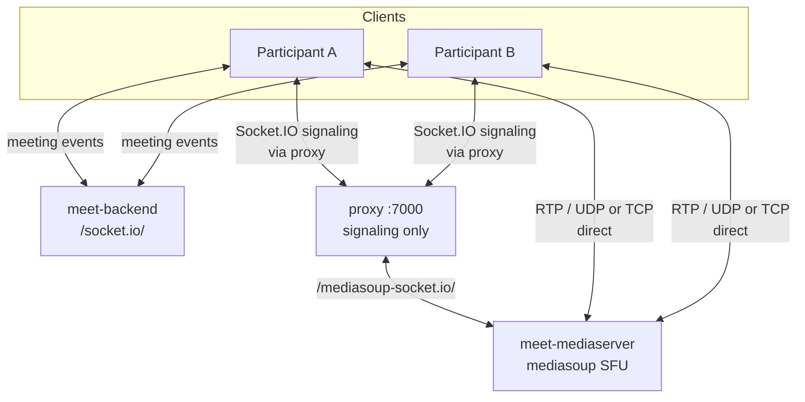
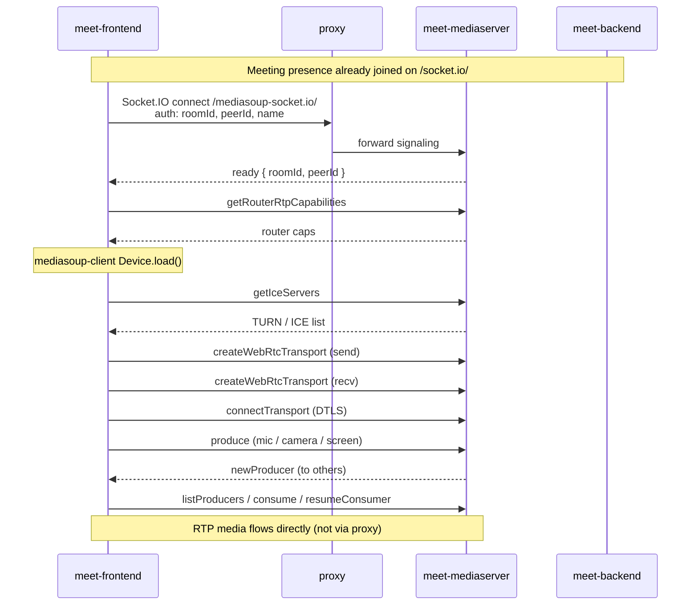
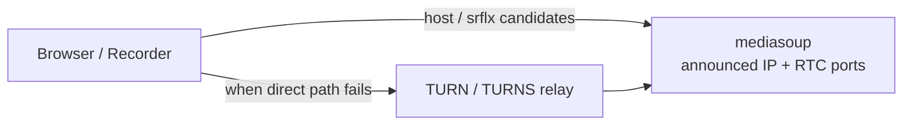

# Avnik — Audio / Video Communication (mediasoup)

High-level overview of how real-time audio and video work in Avnik meetings: signaling vs media paths, SFU roles, client join flow, TURN/ICE, and recording.

For the full service map and HTTP proxy, see [architecture-overview.md](./architecture-overview.md).

---

## 1. Big picture

Avnik uses a **Selective Forwarding Unit (SFU)** based on [mediasoup](https://mediasoup.org/). Each participant uploads (produces) their own media to the SFU; the SFU forwards (consumes) selected streams to everyone else. Peers do **not** send camera/mic RTP to each other directly.

Two separate real-time channels exist:

| Channel | Service | Socket.IO path | Purpose |
|---------|---------|----------------|---------|
| **Meeting control** | `meet-backend` (NestJS) | `/socket.io/` | Presence, waiting room, chat, host actions, recording start/stop |
| **Media signaling** | `meet-mediaserver` | `/mediasoup-socket.io/` | WebRTC transports, produce/consume, ICE server list |

**Media packets (RTP)** never go through nginx or the Nest API. After signaling completes, browsers send/receive media **directly** to the mediaserver’s announced IP and RTC UDP port range.



---

## 2. Components

| Component | Folder | Role in A/V |
|-----------|--------|-------------|
| `meet-mediaserver` | `meet-mediaserver/` | mediasoup Worker + Router per room; WebRTC transports; producer/consumer fan-out |
| `meet-frontend` | `meet-frontend/src/features/mediasoup/` | `mediasoup-client` Device, send/recv transports, local produce + remote consume |
| `meet-backend` | `meet-backend/` | Meeting lifecycle; optional `POST /meet/api/media/token` (JWT); does **not** forward RTP |
| `proxy` | `proxy/routes*.conf` | Proxies **signaling** (`/mediasoup-socket.io/`) only |
| `meet-recorder` | `meet-recorder/` | Headless Chrome joins as **receive-only** SFU peer and records canvas + audio |

---

## 3. Rooms and identity

- Nest meeting room id and SFU room id are the **same string** (`roomId`).
- SFU peer id is the meeting **`userId`** (`peerId`).
- The mediaserver creates a mediasoup **Router** the first time someone connects to that `roomId`, and tears it down when the last peer leaves.
- Nest does not create SFU rooms via HTTP; the SFU is independent and keyed only by `roomId`.

**Codecs** (mediaserver worker): **Opus** (audio), **VP8** (video).

---

## 4. Signaling vs media paths

```text
Browser
  │
  │  1) HTTPS same-origin
  │     /mediasoup-socket.io/   ←── Socket.IO (SDP / ICE / produce / consume)
  ▼
proxy :7000
  │
  │  prod → host.docker.internal:3001   (mediaserver network_mode: host)
  │  dev  → meet-mediaserver:3001       (compose bridge network)
  ▼
meet-mediaserver  (PORT / MEDIASERVER_PORT, typically 3001)

Browser
  │
  │  2) Direct WebRTC
  │     UDP (and/or TURN relay) to MEDIASERVER_ANNOUNCED_IP
  │     ports MEDIASERVER_RTC_MIN_PORT … MEDIASERVER_RTC_MAX_PORT
  ▼
meet-mediaserver mediasoup Worker
```

**Rule of thumb:** nginx/proxy = **control plane** for media; RTP = **data plane** straight to the SFU.

---

## 5. Client join flow (happy path)

After the user is admitted into the live meeting on Nest:



### Media sources

Each producer is tagged with `appData.source`:

| Source | Typical use |
|--------|-------------|
| `mic` | Microphone |
| `camera` | Webcam |
| `screen` | Screen share video |
| `screen-audio` | Screen share audio |

Replacing a producer of the same kind + source closes the previous one. Remote peers learn about streams via `newProducer` / `producerClosed` / pause-resume events.

### Receive-only mode

The recorder UI sets `consumeOnly` on `MediasoupMediaProvider`: it creates a **recv** transport only (no local `getUserMedia` produce). That lets headless Chrome mix remote A/V without a camera.

---

## 6. SFU internals (mediaserver)

Key modules:

| Module | Responsibility |
|--------|----------------|
| `worker.ts` | mediasoup Worker + codec list |
| `roomManager.ts` | One `MediaRoom` / Router per `roomId` |
| `mediaRoom.ts` | Per-peer send/recv transports; producer & consumer maps |
| `signaling.ts` | Request/response over Socket.IO event `media` |
| `auth.ts` | Handshake credentials or JWT |
| `turnConfig.ts` | Builds ICE server list for clients |

### Signaling message types (client → server)

`getRouterRtpCapabilities` · `getIceServers` · `createWebRtcTransport` · `connectTransport` · `produce` · `consume` · `resumeConsumer` · `listProducers`

Responses echo the request type; push events (e.g. `newProducer`) have no request id.

### Auth

1. **Live SPA path:** Socket.IO `handshake.auth` with `{ roomId, peerId, name? }` (what the frontend uses today).
2. **JWT path (supported, optional):** token from `handshake.auth.token` or query, verified with `MEDIA_JWT_SECRET`. Nest can mint tokens via `POST /meet/api/media/token` (`MediaTokenService`) — same secret must be shared with the mediaserver (`BACKEND_MEDIA_JWT_SECRET` / `MEDIASERVER_MEDIA_JWT_SECRET`).

---

## 7. ICE, announced IP, and TURN



| Setting | Purpose |
|---------|---------|
| `MEDIASERVER_ANNOUNCED_IP` | Public (or reachable) IP(s) mediasoup puts in ICE candidates. Comma-separated allowed. Wrong value → one-way or no media. |
| `MEDIASERVER_RTC_MIN_PORT` / `MAX` | UDP range for RTP (e.g. `45000–45100`). Must be open on the host/firewall. |
| `MEDIASERVER_TURN_URLS` / `USERNAME` / `PASSWORD` | Relays for restrictive NATs; returned by `getIceServers`. Prod build can also bake `VITE_TURN_*` into the frontend as fallback. |

**Dev:** mediaserver runs on the Docker network; RTC ports are published on the host.  
**Prod:** mediaserver often uses `network_mode: host` so RTP binds on the server’s real interfaces; proxy reaches signaling via `host.docker.internal:3001`.

---

## 8. How the frontend finds the SFU

Resolution order (simplified):

1. Recorder may pass an explicit media URL (`mediaWs` / `RECORDER_MEDIA_PUBLIC_WS_URL`) when needed.
2. Otherwise prefer **same-origin** `/mediasoup-socket.io/` (through Vite dev proxy or the edge `proxy` container).
3. Optional override: `VITE_MEDIA_WS_URL` for an absolute SFU origin.

Default Socket.IO path: `/mediasoup-socket.io` (`VITE_MEDIA_SOCKET_PATH`).

Primary UI wiring lives in:

- `MediasoupMediaProvider.tsx` — join SFU, produce/consume lifecycle  
- `MediaSignaling.ts` — request/response helper on the `media` event  
- `resolveMediaSocketUrl.ts` / `mediaSocketPath.ts` — URL and path helpers  

---

## 9. Recording and mediasoup

```mermaid
sequenceDiagram
  participant Host as Host client
  participant Nest as meet-backend
  participant Rec as meet-recorder
  participant Proxy as proxy
  participant SFU as meet-mediaserver

  Host->>Nest: start recording
  Nest->>Rec: POST /api/recordings/start
  Rec->>Proxy: open /join/record?...&mode=recorder
  Proxy->>SFU: receive-only SFU join (signaling)
  Note over Rec,SFU: Consume remote producers; MediaRecorder<br/>captures composed canvas + mixed audio
  Rec->>Nest: chunks / complete (via meet-backend APIs)
```

- Prefer `RECORDER_FRONTEND_URL=http://proxy:7000/join` so signaling paths match production (API + `/mediasoup-socket.io/`).
- Leave `RECORDER_MEDIA_PUBLIC_WS_URL` empty when same-origin proxy is enough.
- Recorder ICE filtering drops loopback candidates that break Docker networking.

---

## 10. Environment cheat sheet

| Variable | Used for |
|----------|----------|
| `MEDIASERVER_PORT` | Signaling listen port (default `3001`) |
| `MEDIASERVER_ANNOUNCED_IP` | ICE host candidates clients must reach |
| `MEDIASERVER_RTC_MIN_PORT` / `MAX` | mediasoup RTP port range |
| `MEDIASERVER_TURN_*` | TURN relay for browsers |
| `MEDIASERVER_MEDIA_JWT_SECRET` | Verify media JWTs (align with backend) |
| `BACKEND_MEDIA_JWT_SECRET` / `TTL` | Mint media JWTs on Nest |
| `VITE_MEDIA_WS_URL` | Optional absolute SFU origin (usually unset) |
| `VITE_MEDIA_SOCKET_PATH` | Socket.IO path (default `/mediasoup-socket.io`) |
| `VITE_TURN_*` | Client-side TURN fallback (prod build args) |
| `RECORDER_MEDIA_PUBLIC_WS_URL` | Optional SFU URL embedded in recorder page |

---

## 11. Operational checklist

1. **Signaling works but no A/V** → check `MEDIASERVER_ANNOUNCED_IP`, firewall UDP RTC range, and TURN.
2. **Socket.IO media fails** → check proxy `/mediasoup-socket.io/` upstream (dev vs host-network prod).
3. **One participant silent/black** → producer paused/closed, consume/resume path, or codec mismatch (expect Opus/VP8).
4. **Recorder has no media** → ensure recorder loads via `proxy:7000`, `consumeOnly` join succeeds, ICE not stuck on `127.0.0.1`.

---

## 12. Related code map

| Area | Path |
|------|------|
| SFU server | `meet-mediaserver/src/` (`server.ts`, `mediaRoom.ts`, `signaling.ts`, `worker.ts`) |
| SFU client | `meet-frontend/src/features/mediasoup/` |
| Media JWT API | `meet-backend/src/media/` |
| Proxy (prod) | `proxy/routes.conf` → `host.docker.internal:3001` |
| Proxy (dev) | `proxy/routes.dev.conf` → `meet-mediaserver:3001` |
| Architecture | [architecture-overview.md](./architecture-overview.md) |
